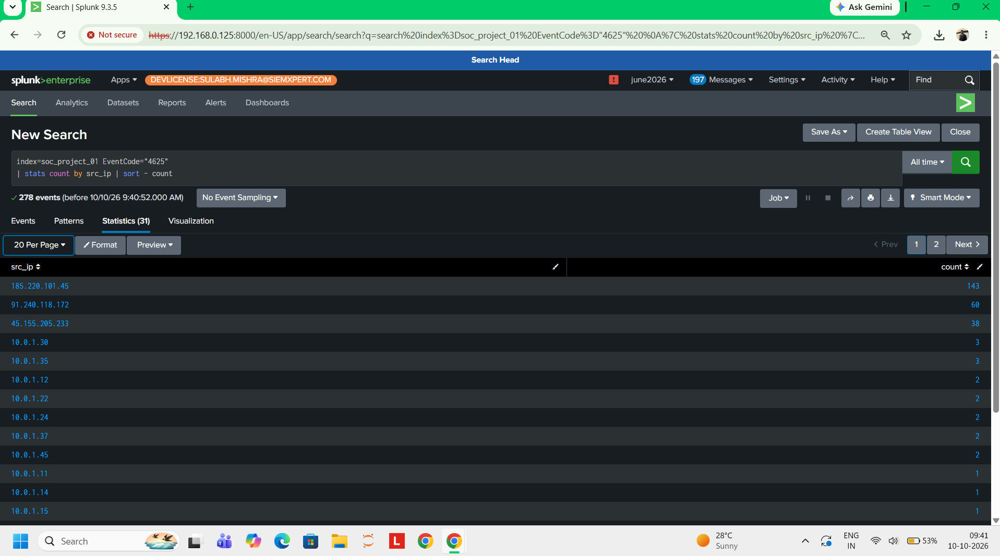
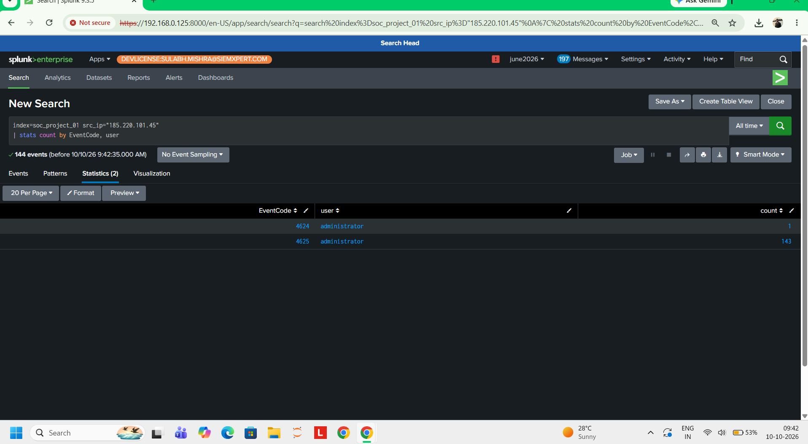
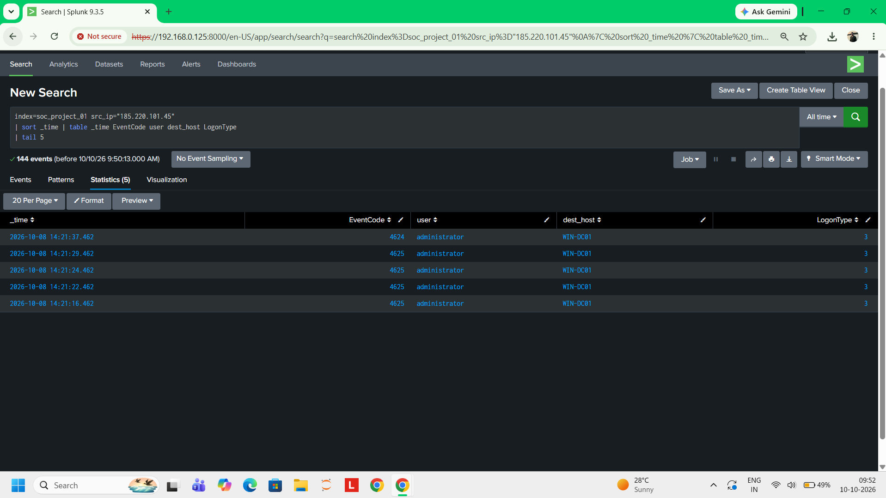
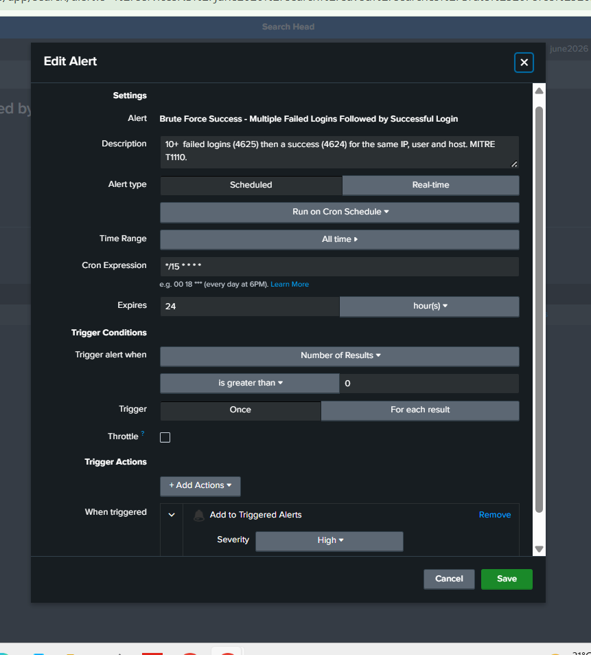
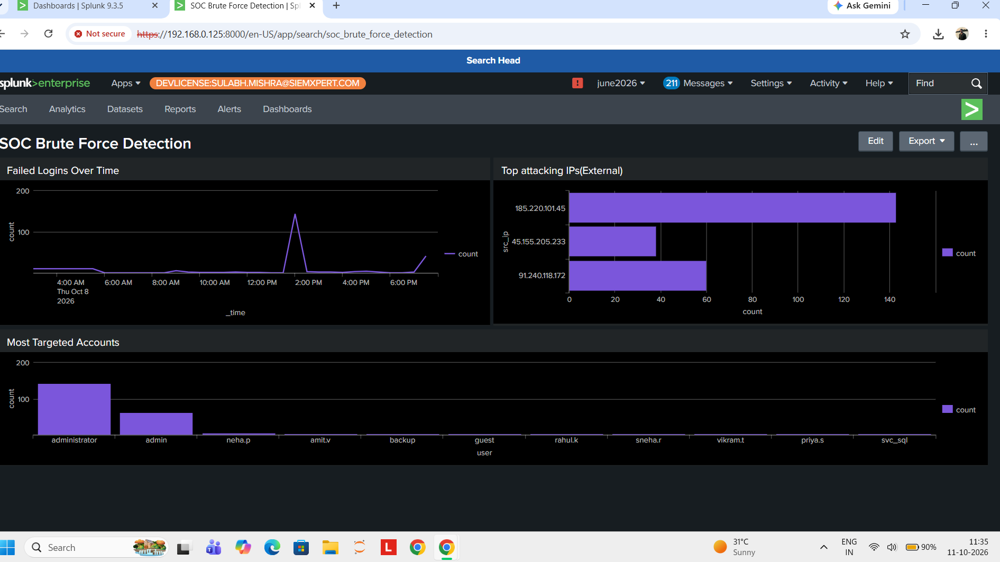

# Detecting a Successful Brute-Force Attack in Splunk

A small SOC analyst project where I investigated failed and successful Windows logins in Splunk, found a brute-force attack that ended in a break-in, and then built an alert and a dashboard so it would be caught automatically.

**Tools:** Splunk (SPL, alerts, dashboards) | **Data:** Windows Security logon events (Event IDs 4624 and 4625) | **MITRE ATT&CK:** T1110 Brute Force

> **About the data:** the logs in this project are simulated, not from a real company. I built the dataset to look like normal office logins with a few attacks hidden in it, so I could practice finding them. The searches and the detection logic work the same way on real Windows logs.

---

## What I was trying to do

Answer the questions a Tier 1 analyst gets asked when something looks off:

1. Is anything unusual in these logins?
2. Who is doing it?
3. Did they actually get in?
4. When, and on which machine?
5. How do we catch this automatically next time?

## The data

842 events in total: 564 successful logins (4624) and 278 failed logins (4625), spread across four machines (`WIN-DC01`, `WIN-FS01`, `WIN-WS07`, `WIN-WS12`).

Fields: `timestamp`, `EventCode`, `user`, `src_ip`, `dest_host`, `LogonType`, `Status`. The file is in `data/windows_security_logs_v2.csv`.

I uploaded it into its own index (`soc_project_01`) so it stayed separate from the lab's other data.

One thing I ran into: my first upload used a column called `host`, and Splunk replaced it with its own built-in host value, so every event showed the Splunk server instead of the real machine. I renamed the column to `dest_host` and re-uploaded.

---

## Investigation

### 1. Spotting the suspicious IPs

About a third of all logins were failures, which is far higher than normal for an office. I counted failures by source IP:

```
index=soc_project_01 EventCode=4625 | stats count by src_ip | sort - count
```



Internal addresses (`10.0.1.x`) had 2 or 3 failures each, which looks like normal typos. Three outside IPs stood out: `185.220.101.45` (143), `91.240.118.172` (60) and `45.155.205.233` (38).

### 2. Did the worst one get in?

Failed attempts alone only prove someone tried. So I looked at everything that single IP did:

```
index=soc_project_01 src_ip=185.220.101.45 | stats count by EventCode, user
```



143 failed logins on `administrator`, followed by 1 successful login on the same account. That is a successful brute-force attack.

### 3. When and where

```
index=soc_project_01 src_ip=185.220.101.45 | sort _time | table _time EventCode user dest_host LogonType | tail 5
```



The last failures come a few seconds apart, then the success at 14:21:37 on `WIN-DC01`, a domain controller, with logon type 3 (network). The attempts started at 14:12:00, so the attack ran for about 9 minutes 37 seconds at roughly one guess every 4 seconds. That speed points to a tool guessing passwords, not a person.

### Incident summary

Between 14:12:00 and 14:21:37 on 8 Oct 2026, the external IP `185.220.101.45` made 143 failed logins against the `administrator` account on `WIN-DC01`, then logged in successfully at 14:21:37. Because it is an admin account on a domain controller, I would treat this as critical: escalate to Tier 2, block the source IP, reset the account's password, and check what that session did after logging in.

---

## Detection: turning it into an alert

I wrote a search that looks for the exact pattern, many failures followed by a success for the same IP, user and host:

```
index=soc_project_01 (EventCode=4625 OR EventCode=4624)
| stats count(eval(EventCode=4625)) as failures count(eval(EventCode=4624)) as successes by src_ip, user, dest_host
| where failures>=10 AND successes>=1
```

It returns one row, the attack above. Normal staff never go over 3 failures, so a threshold of 10 keeps typos out.

I saved it as a scheduled alert that runs every 15 minutes, triggers when it returns any result, and is set to High severity.



**A note on the time range:** I set the alert to search "All time" only so it would fire on my old simulated data. In a real setup it should use a rolling window like the last 15 minutes, so it doesn't keep re-alerting on the same event.

---

## Dashboard

Three panels that show the whole story on one screen: failed logins over time (the spike at 14:00 is the attack), the top external attacking IPs, and the accounts being targeted most.



---

## Other things I noticed

These did not become alerts, but I would follow up on them in a real environment:

- **`45.155.205.233`** tried 38 failed logins spread across about 10 different accounts on `WIN-FS01`, a few each. That looks like a password spray, and it never got in.
- **`91.240.118.172`** made 60 failed RDP logins (logon type 10) against `admin` on `WIN-WS12`, roughly one every 3 minutes from about 03:00. That is a slow brute force built to stay under simple thresholds, and it also never got in.

## What I would improve

- Add rules for the password spray (many accounts, few tries each) and the slow attack (low rate, long time).
- Enrich the IPs with threat intelligence before deciding severity.
- Add account lockout checks, since nothing stopped 143 attempts in a row.
- Run it against a real attack, for example a Hydra run from Kali against a test Windows machine.

## Repo contents

```
README.md
data/windows_security_logs_v2.csv
screenshots/
  01-top-attacking-ips.png
  02-bruteforce-proof.png
  03-breakin-timeline.png
  04-alert.png
  05-dashboard.png
```
